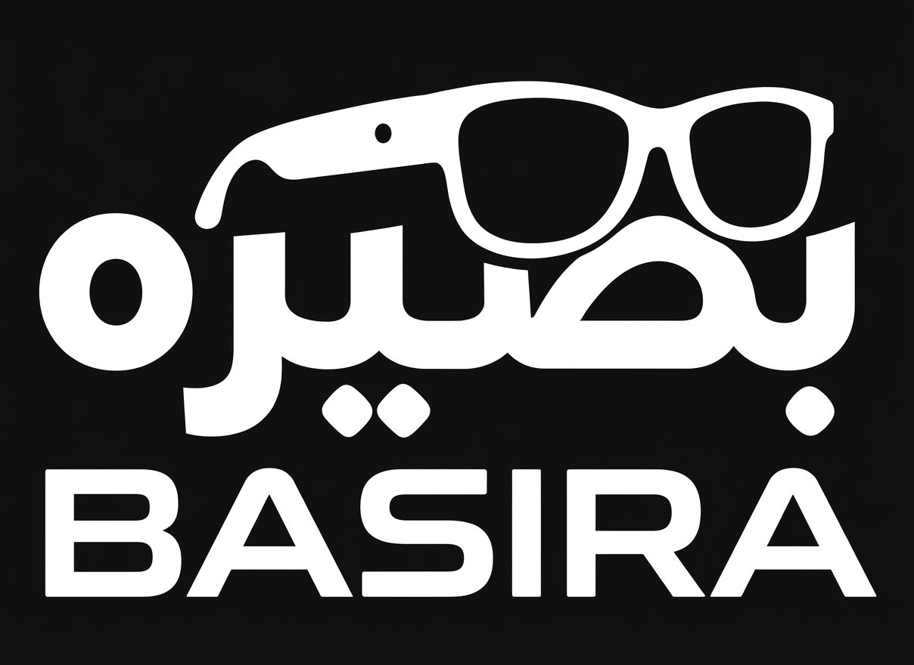

# Basira — AI-Powered Assistive Smart Glasses

### An Intelligent Wearable Assistive System for Enhanced Mobility, Awareness, and Safety

[Python](https://www.python.org/) · [Flutter](https://flutter.dev/) · [Flask](https://flask.palletsprojects.com/) · [SQLite](https://sqlite.org/) · [Raspberry Pi](https://www.raspberrypi.com/) · [ESP32](https://www.espressif.com/en/products/socs/esp32) · [Computer Vision](https://opencv.org/) · [Figma](https://www.figma.com/)

  

**Basira** is an AI-powered assistive smart glasses project developed as a collaborative graduation project by a Computer Engineering team at Taif University.

The project explores the integration of Artificial Intelligence (AI), Computer Vision, Embedded Systems, Internet of Things (IoT), and mobile application technologies into a wearable assistive solution designed to support people with visual impairments.

The system combines smart glasses equipped with a camera and embedded sensors with AI-powered processing to provide environmental awareness through object detection, facial recognition, distance estimation, and assistive feedback.

---

## Overview

Basira provides an integrated wearable concept designed to help people with visual impairments better understand their surroundings.

The system combines embedded hardware, AI-powered processing, and a companion mobile application to explore assistive features for environmental awareness, navigation support, and safety.

## Key Features

- **AI-Powered Object Detection:** Identifies objects in the surrounding environment using computer vision.
- **Facial Recognition:** Helps users identify registered individuals.
- **Obstacle Detection:** Uses camera-based detection to identify potential obstacles.
- **Distance Estimation:** Uses a dedicated distance sensor to measure nearby obstacles.
- **Haptic Feedback:** Provides tactile alerts through integrated vibration motors.
- **Mobile Application:** Offers interfaces for system interaction and facial registration.
- **Safety-Related Functionality:** Explores location monitoring and emergency notifications.

## Prototype Design

The following image presents the Basira smart glasses prototype from four different views: front, upper, right, and left.

[Basira Smart Glasses Prototype](https://github.com/Alharthi-Abdulrahman/Basira-AI-Smart-Glasses/blob/main/02-prototype-design.jpg) ([image](https://github.com/Alharthi-Abdulrahman/Basira-AI-Smart-Glasses/raw/main/02-prototype-design.jpg))

## System Design & Architecture

### 1. System Analysis

The system analysis illustrates the problem domain and the main requirements considered during the development of Basira.

[Basira System Analysis](https://github.com/Alharthi-Abdulrahman/Basira-AI-Smart-Glasses/blob/main/03-system-analysis.jpg) ([image](https://github.com/Alharthi-Abdulrahman/Basira-AI-Smart-Glasses/raw/main/03-system-analysis.jpg))

### 2. Overall System Architecture

Basira integrates three main components:

- **Smart Glasses:** The wearable component containing the camera, sensors, and feedback hardware.
- **Embedded Processing and Sensors:** Integrates Raspberry Pi and ESP32 platforms with connected sensors and processing components.
- **Mobile Application:** Provides interfaces for interacting with the system and managing supported features.

[Basira Overall System Architecture](https://github.com/Alharthi-Abdulrahman/Basira-AI-Smart-Glasses/blob/main/04-overall-architecture.jpg) ([image](https://github.com/Alharthi-Abdulrahman/Basira-AI-Smart-Glasses/raw/main/04-overall-architecture.jpg))

### 3. Methods and Requirements

Presents the development methodology and the functional and technical requirements considered during the design and development of the system.

[Basira Methods and Requirements](https://github.com/Alharthi-Abdulrahman/Basira-AI-Smart-Glasses/blob/main/05-methods-requirements.jpg) ([image](https://github.com/Alharthi-Abdulrahman/Basira-AI-Smart-Glasses/raw/main/05-methods-requirements.jpg))

### 4. System Interfaces

Showcases the user-facing interface concepts and application screens designed for the Basira project.

[Basira System Interfaces](https://github.com/Alharthi-Abdulrahman/Basira-AI-Smart-Glasses/blob/main/06-system-interfaces.jpg) ([image](https://github.com/Alharthi-Abdulrahman/Basira-AI-Smart-Glasses/raw/main/06-system-interfaces.jpg))

## Hardware Components

| Component | Purpose |
|---|---|
| Raspberry Pi 4 | Main embedded computing platform |
| ESP-WROOM-32 (ESP32) | Microcontroller and hardware integration |
| Raspberry Pi Camera Module 2 | Image and video capture |
| TOF10120 | Distance measurement |
| MPU-6050 IMU | Motion and orientation sensing |
| Coin Vibration Motors | Haptic feedback |

## Technology Stack

| Area | Technologies |
|---|---|
| AI & Image Processing | Python, Computer Vision |
| Backend | Flask |
| Mobile Application | Flutter |
| Database | SQLite |
| Embedded Computing | Raspberry Pi 4 |
| Microcontroller | ESP32 |
| Hardware Programming | Arduino IDE |
| UI/UX Design | Figma |
| Development Environment | Android Studio, Visual Studio Code |

## Implementation Highlights

The project brings together multiple areas of Computer Engineering:

- Integration of AI-powered computer vision capabilities.
- Development of facial recognition functionality.
- Camera-based object detection.
- Distance measurement using a dedicated sensor.
- Embedded hardware integration using Raspberry Pi and ESP32.
- Vibration-based assistive feedback.
- Companion mobile application development.
- Database integration for supported application functionality.

## Project Objectives

- Explore AI-powered assistive technologies for people with visual impairments.
- Improve environmental awareness through computer vision.
- Support facial recognition and obstacle detection.
- Provide additional feedback through haptic alerts.
- Integrate embedded systems with mobile application technologies.
- Explore safety-oriented features in a connected wearable system.

## Scope and Limitations

Basira is an academic graduation project developed to explore the integration of AI, computer vision, embedded systems, and mobile technologies into an assistive wearable solution.

The described features represent the project's documented functionality and development scope. Performance, reliability, and real-world effectiveness may depend on environmental conditions, hardware limitations, and system integration.

Basira is not intended to replace existing mobility aids or professional assistance.

## Future Development

Potential areas for further development include:

- Improving object detection accuracy and environmental understanding.
- Enhancing facial recognition performance under different lighting conditions.
- Improving distance estimation and obstacle detection.
- Optimizing embedded processing and power consumption.
- Expanding mobile application functionality.
- Further testing and evaluating system performance in real-world environments.

## Project Information

| Item | Details |
|---|---|
| Project Name | Basira |
| Institution | Taif University |
| Department | Computer Engineering |
| Project Type | Collaborative Graduation Project |
| Project Duration | August 2025 – June 2026 |

## Developer

**Abdulrahman Alharthi**

Computer Engineering Graduate

- GitHub: [@Alharthi-Abdulrahman](https://github.com/Alharthi-Abdulrahman)
- LinkedIn: [Abdulrahman Alharthi](https://www.linkedin.com/in/abdulrahman-al-harthi-8355353aa)

---

**Basira**  
*An Intelligent Wearable Assistive System for Enhanced Mobility, Awareness, and Safety.*
