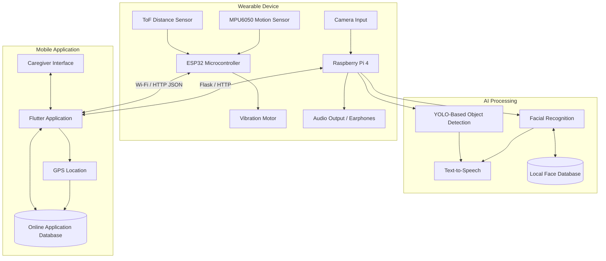

# System Architecture

## 1. Overview

Basira is an AI-powered assistive wearable system designed to support visually impaired users through environmental awareness, obstacle detection, facial recognition, and remote safety monitoring.

The system follows a distributed architecture consisting of three primary components:

- **Raspberry Pi Processing Unit:** Handles image processing, AI-based object detection, facial recognition, and voice feedback.
- **ESP32 Sensor Unit:** Collects distance and motion data, processes proximity-based responses, and provides vibration feedback.
- **Flutter Mobile Application:** Provides user management, facial registration, location tracking, and caregiver monitoring.

These components work together to combine computer vision, embedded sensing, wireless communication, and mobile application technologies.

## 2. High-Level Architecture

The following diagram illustrates the main components and their interactions.

## 3. Main Architectural Components

### 3.1 Raspberry Pi Processing Unit

The Raspberry Pi 4 serves as the primary processing unit for the computer vision and AI-related operations.

Its responsibilities include:

- Receiving visual input from the camera.
- Processing image frames using Python-based applications.
- Performing object detection using the YOLO framework.
- Running facial recognition to identify previously registered individuals.
- Generating voice instructions and alerts through a Text-to-Speech (TTS) engine.
- Hosting a Flask-based service for facial recognition and communication with the mobile application.

The facial recognition implementation uses OpenCV and the Face Recognition library. Registered facial data and associated information are stored in a MySQL database on the Raspberry Pi.

### 3.2 ESP32 Sensor Unit

The ESP32 is responsible for low-level sensor operations and proximity-based feedback.

Its main responsibilities include:

- Reading distance measurements from a Time-of-Flight (ToF) sensor.
- Acquiring motion data from the MPU6050 accelerometer and gyroscope.
- Evaluating proximity measurements to determine obstacle distance.
- Adjusting vibration motor intensity according to the detected distance.
- Exposing sensor information through a Wi-Fi-connected HTTP server.

The ESP32 provides sensor information through a JSON endpoint, allowing connected devices to retrieve measurements such as obstacle distance, vibration intensity, and acceleration data.

### 3.3 Mobile Application

The mobile application is developed using Flutter and acts as the user-facing interface for the Basira system.

Its main functions include:

- User registration and management.
- Assigning relationships between users and caregivers.
- Registering familiar faces through the Raspberry Pi facial recognition service.
- Accessing the camera interface for face registration.
- Displaying user location through GPS-based tracking.
- Providing caregivers with a monitoring interface.
- Supporting Arabic and English interfaces.

The application communicates with the Raspberry Pi facial recognition service through a Flask-based web interface and accesses sensor information through the ESP32 HTTP service.

Location information is stored in the application's online database and displayed through the map interface.

## 4. System Data Flow

The system operates through several interconnected data-processing paths.

### 4.1 Object Detection and Voice Guidance

1. The camera captures visual information from the user's surroundings.
2. The Raspberry Pi receives and processes the captured frames.
3. The YOLO-based model identifies and classifies objects.
4. The processing application generates relevant voice descriptions or warnings.
5. Audio feedback is delivered to the user through earphones.

### 4.2 Distance Sensing and Haptic Feedback

1. The ToF sensor measures the distance to nearby objects.
2. The ESP32 continuously reads the distance measurements.
3. The firmware evaluates proximity and determines the appropriate vibration intensity.
4. The vibration motor provides tactile feedback.
5. Sensor readings are made available through the ESP32 HTTP server.

### 4.3 Facial Recognition

1. The mobile application provides an interface for registering a familiar person.
2. The Raspberry Pi camera captures the facial image through the Flask service.
3. OpenCV and the Face Recognition library process the captured image.
4. A facial encoding is generated and stored with the person's information in the local MySQL database.
5. During subsequent recognition, captured facial information is compared against registered records.
6. The system can provide identity information through its feedback mechanism.

### 4.4 Location Tracking and Caregiver Monitoring

1. The mobile application obtains the user's GPS location.
2. Location coordinates and timestamps are stored in the online application database.
3. The application updates location information periodically.
4. Caregivers can access the monitoring interface and view the user's location on a map.

## 5. Communication Architecture

The system uses different communication methods depending on the component and its function.

| Communication Method | Purpose |
|---|---|
| Wi-Fi | Wireless communication with the ESP32 sensor unit |
| HTTP / JSON | Retrieving sensor readings from the ESP32 |
| Flask / HTTP | Connecting the mobile application to Raspberry Pi facial recognition services |
| GPS | Obtaining the user's geographical location |
| Mobile application backend | Managing user information and location records |

## 6. Architecture Design Considerations

The architecture separates computationally intensive operations from low-level hardware control.

- **Processing separation:** AI and image-processing tasks run on the Raspberry Pi, while sensor acquisition and vibration control are handled by the ESP32.
- **Modularity:** The main subsystems have distinct responsibilities, making individual components easier to maintain and develop.
- **Real-time interaction:** Visual processing and distance sensing provide information for timely audio and tactile feedback.
- **Mobile integration:** The companion application connects the wearable system with users and caregivers.
- **Extensibility:** The architecture provides a foundation for future improvements in AI processing, sensor integration, and accessibility features.

## 7. Implementation Notes and Scope

This documentation describes the architecture and implementation approach presented in the Basira project report.

Some functions were evaluated through simulation, while other components were documented as practical software and hardware implementations. The architecture diagram represents the logical system design and communication relationships; it should not be interpreted as proof that every subsystem was fully integrated and validated under all real-world operating conditions.

Further improvements may include optimized edge AI processing, enhanced sensor fusion, improved low-light performance, and stronger security mechanisms.

---

**Project:** Basira — AI-Powered Assistive Smart Glasses

**Project Period:** August 2025 – June 2026

**Field:** Computer Engineering, Artificial Intelligence, Embedded Systems, IoT, and Mobile Application Development
